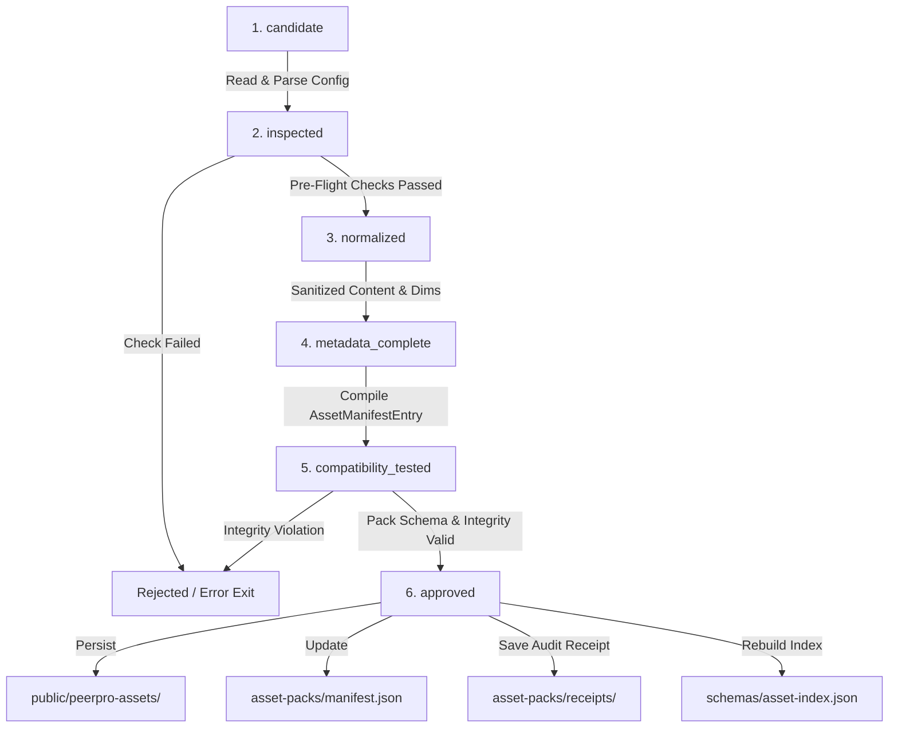

# PeerPro Asset Foundry & Pack Ingestion Guide

The **Asset Foundry** is PeerPro's automated, provider-agnostic subsystem for onboarding candidate artwork into production asset packs. Whether assets are hand-drawn in vector software, purchased under commercial license, procedurally generated, or created with AI image tools, the Foundry turns candidate artwork into verified, normalized, indexed, and reusable animation assets.

---

## 1. Architectural Philosophy

1. **Provider-Agnostic Ingestion**: PeerPro does not bind to any proprietary image generation API or service. Any valid SVG, PNG, or WebP file meeting PeerPro's structural contracts can be ingested.
2. **Deterministic 6-Stage Lifecycle**: Every candidate moves sequentially through six strict lifecycle states. If any stage fails, the pipeline aborts cleanly without writing partial or corrupt assets to disk.
3. **Auditable Provenance**: Unattributed assets cannot be ingested. Author and license metadata are mandatory and permanently recorded in immutable audit receipts.
4. **Instant Self-Discovery**: Approved assets are automatically indexed into `schemas/asset-index.json`, `docs/asset-index.md`, and `out/contact-sheet.svg`, making them immediately discoverable by AI agents via `npm run agent:discover`.

---

## 2. The 6-Stage Ingestion Lifecycle



### Stage 1: `candidate`
The candidate configuration is loaded. The candidate provides:
- Source file path (`sourcePath`)
- Kebab-case target identifier (`targetId`, e.g. `starter-prop-umbrella`)
- Descriptive name, kind (`prop`, `character_part`, `environment_layer`), and category
- Normalized anchor (`anchor: { x: 0.5, y: 0.88 }`)
- Attachment sockets (e.g. `grip: { x: 160, y: 280 }`, `tip: { x: 160, y: 20 }`)
- Tags and style family
- Mandatory provenance metadata (`source`, `license`, `author`)

### Stage 2: `inspected`
Pre-flight automated inspection runs:
- **File Readability**: Verifies file exists on disk and exceeds the 50-byte threshold (preventing 0-byte corrupt assets).
- **Format Verification**: Checks for supported extensions (`.svg`, `.png`, `.webp`).
- **SVG Structure & ViewBox**: Parses root `<svg>` tag, extracts dimensions and `viewBox`.
- **Security Sanitization**: Scans for dangerous elements (`<script>`, event handlers `onload=`, `onerror=`, `javascript:` protocols).
- **ID Uniqueness**: Verifies kebab-case syntax and confirms no collision exists in the active registry or on-disk pack manifests.
- **Coordinate Bounds**: Verifies anchor coordinates fall within normalized `[0.0, 1.0]`.
- **Provenance Completeness**: Flags any missing author or license fields.

### Stage 3: `normalized`
The asset normalizer standardizes the artwork content:
- Enforces standard XML namespace: `xmlns="http://www.w3.org/2000/svg"`.
- Strips redundant XML declarations (`<?xml ... ?>`), DOCTYPE headers, and editor comments (`<!-- ... -->`).
- Strips inline scripts and dangerous handlers.
- Synthesizes clean `viewBox="0 0 W H"` if missing from width/height attributes.

### Stage 4: `metadata_complete`
Assembles the complete `AssetManifestEntry`:
- Derives public relative path (`peerpro-assets/starter/<targetId>.svg`).
- Grants automatic capabilities (`['scalable', 'flip_x']` for vector assets).
- Bundles normalized dimensions, anchor point, and attachment sockets.

### Stage 5: `compatibility_tested`
Creates a hypothetical updated asset pack manifest containing the new asset and executes `validateAssetPackManifest`:
- Validates against the strict Zod `AssetPackManifestSchema`.
- Confirms directory traversal safety (no `..` or absolute paths).
- Validates coordinate numbers (no `NaN`).
- Checks style family consistency with the target pack.

### Stage 6: `approved`
On approval (when not running in `--dry-run` mode):
1. **Asset File**: Written to `public/peerpro-assets/<packId>/<targetId>.<ext>`.
2. **Pack Manifest**: Manifest in `asset-packs/<packId>/manifest.json` is updated and sorted.
3. **Audit Receipt**: Immutable audit receipt saved to `asset-packs/<packId>/receipts/<targetId>.json`.
4. **Index Regeneration**: Automatically runs `npm run assets:index` and `npm run assets:contact-sheet`.

---

## 3. CLI Usage

PeerPro provides a dedicated CLI script for automated asset ingestion:

```bash
# Ingest via candidate configuration file
npm run asset:ingest -- --config=candidates/props/umbrella-candidate.json

# Test in Dry-Run mode without writing any files
npm run asset:ingest -- --config=candidates/props/umbrella-candidate.json --dry-run

# Ingest with CLI arguments directly
npm run asset:ingest -- path/to/icon.svg --id=starter-prop-scroll --name="Ancient Scroll" --kind=prop --category=prop --tags=scroll,ancient,paper --author="PeerPro Team"
```

### Candidate JSON Configuration Schema

```json
{
  "sourcePath": "candidates/props/starter-prop-umbrella.svg",
  "targetId": "starter-prop-umbrella",
  "name": "Classic Cel-Shaded Japanese Umbrella",
  "kind": "prop",
  "category": "prop",
  "styleFamily": "anime-clean-v1",
  "viewAngle": "front",
  "variant": "navy",
  "anchor": {
    "x": 0.5,
    "y": 0.88
  },
  "attachmentSockets": {
    "grip": {
      "x": 160,
      "y": 280
    },
    "tip": {
      "x": 160,
      "y": 20
    }
  },
  "tags": [
    "prop",
    "umbrella",
    "rain",
    "weather",
    "handheld",
    "outdoor"
  ],
  "provenance": {
    "source": "original",
    "license": "MIT",
    "author": "PeerPro Team",
    "notes": "Ingested via Asset Foundry during Phase 22 to fulfill weather and rain scene capabilities."
  },
  "targetPackId": "starter-kit",
  "targetSubdir": "peerpro-assets/starter"
}
```

---

## 4. Case Study: Ingesting `starter-prop-umbrella`

During Phase 21 (Creative Generalization Challenge C6), the audit suite identified that props like umbrellas were missing from the catalog, triggering honest validation rejections.

In Phase 22, the Foundry ingested `starter-prop-umbrella`:
- **Candidate Vector Art**: `candidates/props/starter-prop-umbrella.svg` (320x320 cel-shaded indigo anime canopy, silver ferrule, metal shaft, and J-hook handle).
- **Anchor**: `(0.5, 0.88)` anchored to the handle grip.
- **Sockets**: `grip` at `(160, 280)` and `tip` at `(160, 20)`.
- **Result**: Catalog grew from **44 to 45 assets**.
- **Real Scene Proof**: Staged in `scenes/umbrella-rain-showcase.json` with student Ren sheltering under the umbrella on a rainy Tokyo street corner.
