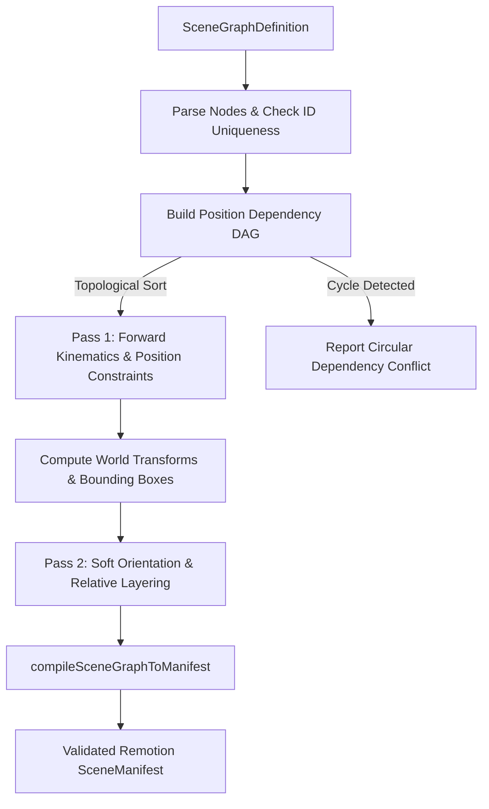

# PeerPro Scene Graph & Spatial Constraints Guide

The **Scene Graph & Spatial Constraints Subsystem** (`src/core/scenegraph/`) enables AI agents and human animators to direct scenes through relational spatial intent ("place textbook on the desk", "attach umbrella to shoulder socket", "turn toward speaker") instead of manually guessing and hardcoding absolute pixel coordinates.

This subsystem directly resolves the **Rank 1 Architectural Gap** identified in Phase 21 by decoupling spatial relationships from absolute viewport values.

---

## 1. Architectural Model & Coordinate Spaces

PeerPro defines four standard coordinate spaces:

1. **`world` Space**:
   - The canonical 2D stage canvas ($1920 \times 1080$ by default).
   - Origin `(0, 0)` is at the top-left corner.
2. **`parent` Local Space**:
   - Relative to a parent entity's origin and anchor point.
   - Child transforms automatically inherit parent translation, scale, rotation, and horizontal flipping.
3. **`character` Local Space**:
   - Relative to character rig root sockets (e.g. `neck`, `shoulder_left`, `shoulder_right`, `hand`).
4. **`screen` Space**:
   - Post-camera viewport coordinates after applying 2.5D parallax displacement:
     $$\text{ScreenShift}_X = - \Delta C_x \times z$$
     $$\text{ScreenShift}_Y = - \Delta C_y \times z$$

---

## 2. Supported Spatial Constraints

| Constraint Type | Parameters | Behavioral Description |
|---|---|---|
| **`attach_socket`** | `targetId`, `targetSocket`, `offset` | Attaches entity anchor to a named socket on the target asset or parent (e.g. `grip`, `neck`, `shoulder_right`). |
| **`place_on_surface`** | `targetId` (or ground), `offset` | Computes entity world $Y$ so its bottom edge rests on the target entity's top surface (or the room ground baseline). |
| **`align`** | `targetId`, `alignment`, `offset` | Aligns entity bounding box horizontally (`'left'`, `'center'`, `'right'`) or vertically (`'top'`, `'bottom'`) with target bounds. |
| **`relative_offset`** | `targetId`, `offset: { x, y }` | Maintains a precise $(\Delta x, \Delta y)$ offset relative to target entity origin. |
| **`safe_region`** | `region: { minX, minY, maxX, maxY }` | Clamps entity bounding box to stay within viewport safety margins. |
| **`layer_relative`** | `targetId`, `relation: 'front_of' \| 'behind'` | Determines relative rendering order (`effectiveOrder`), ensuring foreground or background occlusion. |
| **`look_toward`** | `targetId` | Evaluates relative horizontal direction $(\Delta X = X_{\text{target}} - X_{\text{self}})$ and sets `flipX` and gaze direction toward target. |

---

## 3. Two-Pass Deterministic Solving Algorithm



### Pass 1: Forward Kinematics & Hard Position Constraints
- Builds a dependency graph containing parent-child links and position-affecting constraints (`attach_socket`, `place_on_surface`, `align`, `relative_offset`).
- Executes topological sort with cycle detection. If a cyclic loop is detected (e.g. $A \to B \to A$), the solver aborts with actionable diagnostics.
- Propagates transformations from root to leaf entities:
  $$W_x = P_x + (F_P \text{ ? } -L_x : L_x) \times S_{Px}$$
  $$W_y = P_y + L_y \times S_{Py}$$
- Evaluates surface grounding, alignments, and socket attachments.

### Pass 2: Soft Orientation & Relative Layering
- Evaluates `look_toward` and `layer_relative` across all resolved entities.
- Allows characters to look toward each other without triggering false cyclic position dependencies.

---

## 4. CLI Tooling

PeerPro provides a dedicated CLI tool to inspect scene graphs and compile them into Remotion scene manifests:

```bash
# Inspect scene graph and display spatial diagnostics report
npm run scenegraph:inspect scenes/scenegraph-classroom-desk.json

# Inspect and compile to runnable SceneManifest
npm run scenegraph:inspect scenes/scenegraph-classroom-desk.json --compile=scenes/classroom-study-compiled.json

# Render compiled scene directly
npx tsx scripts/render-scene.ts scenes/classroom-study-compiled.json out/classroom-study.png --frame 45
```

---

## 5. Provenance & Acceptance Proofs

1. **Classroom Desk Group (`scenes/scenegraph-classroom-desk.json`)**:
   - Moving the main study desk from $X = 760$ to $X = 1050$ automatically shifts the chair, the seated student, the tabletop clock prop, the teacher lectern, and the speaker by $+290\text{px}$ without manual coordinate updates.
   - The tabletop clock rests on the desk surface via `place_on_surface:main-desk`.
   - The speaking student faces the seated student via `look_toward:seated-student`.
2. **Umbrella Interaction Scene (`scenes/scenegraph-umbrella-held.json`)**:
   - The newly ingested umbrella prop is placed relative to Ren's body via `relative_offset:sheltered-ren` and layered in front via `layer_relative:front_of(sheltered-ren)`.
   - Ren and a classmate face each other mutually via reciprocal `look_toward` constraints.
